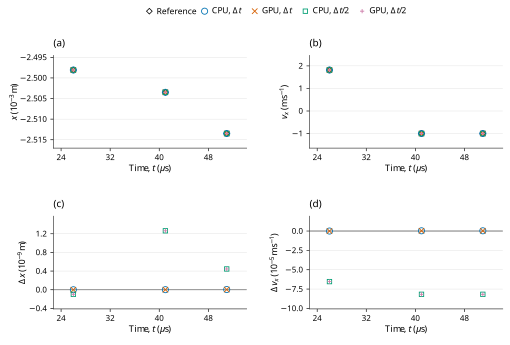

# Damped Hertz collision: LAMMPS benchmark verification

**Case:** `dem01-hertz-twosphere`  
**Evidence date:** 28 October 2026  
**Historical outcome:** **PASS**

## Abstract

This study examines restitution and normal energy loss in a symmetric damped Hertz collision using pinned LAMMPS inputs and analytic assertions. The measured restitution is 0.499941672926 at the base step and 0.499982718075 at the half step, compared with the prescribed value 0.5. CPU and GPU calculations at the original and halved time steps give the historical outcome **PASS**. The measurements are retained campaign evidence; this revision changes their scientific presentation and does not certify a new run of the current core.

## 1. Benchmark definition

The benchmark is defined by the official input and saved reference states [1]; its analytic quantities and acceptance procedure are specified by the official checker [2]. The source commit is `f9720ce2d176d615495d1d6c31349b1f71be1c73` and the input Git blob is `9029229be2a7123a3a5c9aef4d04e2df5a0bc9e0`. LAMMPS was not rerun locally. The pinned upstream inputs and their original qualifications are retained.

**Table 1.** Physical configuration, coefficient mapping and integration settings. Values are in SI units except the explicitly mapped reduced-unit input where stated.

| Quantity | Official input / FunDEM configuration |
|---|---:|
| Two identical spheres | Diameter 0.005 m; density 2700 kg/m^3 |
| Initial centers | (-0.002550, 0, 0), (+0.002550, 0, 0) m |
| Initial x velocities | +2 and -2 m/s; incoming relative speed 4 m/s |
| Initial z spins | +22 and -22 rad/s |
| Young's modulus; Poisson ratio | 7.0e10 Pa; 0.33 |
| Effective modulus; reduced mass | 39277297721.9 Pa; 8.83572933822e-05 kg |
| Restitution; sliding friction | 0.5; 0.4 |
| Rolling / torsional friction; gravity / global damping | All 0 |
| Explicit contact damping override | Off; automatic restitution-based damping active |
| Official time step; duration | 1e-8 s; 51 us |
| Official checkpoints | 2600, 4100, 5100 cumulative steps |
| Native material encoding | E = 70000000000 Pa, nu = 0.33, encoded restitution = 0.5, density = 2700 kg/m^3 |

The native material encoding is reported for reproducibility of the dedicated C++ input; it is not an additional fitted reference parameter. Under explicit Hooke stiffness, E and nu do not set the active spring constants. When manual contact damping is enabled, the encoded material restitution does not set the prescribed dashpot.

For the two equal particles, the measured restitution and total x momentum are defined by [2]
$$
\widehat e=-\frac{v_{1x}-v_{2x}}{2v_{\rm in}},\qquad P_x=m_1v_{1x}+m_2v_{2x}.
\tag{1}
$$


## 2. Numerical method and verification procedure

The retained campaign comprises CPU and GPU calculations at \(\Delta t\) and \(\Delta t/2\). The refined runs use twice as many steps, with unchanged initial conditions and duration. Comparisons are made at equal physical times, using twice the base-step index in the refined runs. The native contact solver supplies the reported motion; the analytic reference is used for comparison, not to generate the native response.

2% restitution plus momentum bound.

The official momentum assertion is \(|P_x|\leq\tau(m_1+m_2)v_{\rm in}\), using the same analytic tolerance \(\tau\) as the relative restitution assertion. This is an absolute momentum bound in kg m/s; it is not a relative error about a zero reference.

For a native quantity \(q\) and reference \(q_{\rm ref}\), the error definitions are

$$
\varepsilon_{\rm rel}=\frac{|q-q_{\rm ref}|}{|q_{\rm ref}|},\qquad\varepsilon_{\rm abs}=|q-q_{\rm ref}|.
\tag{2}
$$

An error is accepted when it does not exceed its stated limit. Relative errors and limits are dimensionless; percentage columns equal \(100\varepsilon_{\rm rel}\). Absolute errors carry the units of the quantity. Zero-reference assertions use their stated absolute bounds rather than dividing by zero. The analytic tolerances in [1,2], or separately labeled supplemental diagnostic limits, determine acceptance. The YAML same-code regression epsilon is retained as source metadata and is not adopted as a cross-software acceptance tolerance.

## 3. Results and discussion

**Table 2.** Retained measurements for the two backends and two time steps. Numerical values, error types, limits and decisions are reproduced from the campaign record without refitting. `dt` denotes \(\Delta t\), and `dt/2` denotes the refined step; `um` denotes µm where used.

| Run | Steps / frames | Measured e | Error to target (%) | Final left vx (m/s) | Normal KE fraction |
|---|---:|---:|---:|---:|---:|
| CPU dt | 5100 / 5101 | 0.499941672926 | 0.01166541 | -0.9998833459 | 0.2499416763 |
| GPU dt | 5100 / 5101 | 0.499941672926 | 0.01166541 | -0.9998833459 | 0.2499416763 |
| CPU dt/2 | 10200 / 10201 | 0.499982718075 | 0.00345639 | -0.9999654361 | 0.2499827184 |
| GPU dt/2 | 10200 / 10201 | 0.499982718075 | 0.00345639 | -0.9999654361 | 0.2499827184 |

The restitution error decreases from 0.01166541% to 0.00345639%, while the normal kinetic-energy fraction approaches the nominal value e² = 0.25. The two backends agree to the displayed precision. Equal and opposite initial spins give zero tangential contact slip; friction and tangential damping are therefore outside the active verification scope.



**Figure 1.** Historical checkpoint comparison for dem01-hertz-twosphere. Panels (a) and (b) show position (x component) and velocity (x component) of the selected body 'left'; (c) shows the signed FunDEM-minus-reference residual of (a). Black open diamonds denote pinned LAMMPS saved-state references; blue open circles, orange crosses, green open squares and purple plus signs denote CPU at Δt, GPU at Δt, CPU at Δt/2 and GPU at Δt/2, respectively. Every run uses its retained physical checkpoint times; no time shift, jitter, averaging, fitting or connecting trajectory is used. Coincident symbols are retained with different shapes and sizes. Axes state physical units and explicit powers of ten. Panel (d) shows the signed residual of (b). Both residual panels use linear scales, with zero shown at its true ordinate. These sparse historical checkpoints do not establish a new validation outcome for the current source or a continuous-time error bound.

## 4. Conclusions and limitations

All four retained runs satisfy the stated official analytic criteria for the active trajectory. The historical PASS is restricted to those quantities, sample times and model assumptions; it does not certify inactive contact channels or general many-particle behavior.

Symmetric normal impact; opposite spins cancel tangential slip. Active tangential damping is not validated.

This report reanalyzes the retained 28 October 2026 campaign; no new physical acceptance run is claimed. Distributed CSV checkpoint tables support the reported samples and scalar diagnostics. Full trajectories and native archives remain outside this repository, so the compact tables and figure must not be interpreted as a newly reconstructed complete time history. CPU/GPU agreement and a two-level time-step study are numerical consistency evidence, not independent proof of model equivalence or an asymptotic convergence order.

## References

[1] LAMMPS Development Team. [Official `dem01-hertz-twosphere-3d-si.yaml` input and saved reference states](https://github.com/lammps/lammps/blob/f9720ce2d176d615495d1d6c31349b1f71be1c73/unittest/granular/tests/dem01-hertz-twosphere-3d-si.yaml), commit `f9720ce2d176d615495d1d6c31349b1f71be1c73`.

[2] LAMMPS Development Team. [Analytic DEM verification models, `test_analytic_models.cpp`](https://github.com/lammps/lammps/blob/f9720ce2d176d615495d1d6c31349b1f71be1c73/unittest/granular/test_analytic_models.cpp), same pinned source revision.

## Appendix A. Reproducibility and evidence

Run from the directory containing `FunDEMBeta/`, after the [family build instructions](../../README.md#build-and-run):

```bash
cmake --build build --target lammps_dem01_hertz_twosphere --parallel
build/validation/LAMMPSComparison/lammps_dem01_hertz_twosphere --mode cpu --output build/comparisons/dem01-hertz-twosphere-cpu
```

Reserve a new output directory for each execution. Repeat with `--mode gpu`, `--half-step`, and their combination to obtain CPU/GPU results at both time steps; the half-step option doubles the step count to preserve duration. GPU execution requires a CUDA-enabled build and compatible device. The current dedicated C++ program provides a reproducible setup, but its completion is not a new acceptance certification. Compare its numerical output independently with the physical quantities, times and limits stated above.

- [Native C++ case](dem01-hertz-twosphere.cpp)
- [Exact historical numerical fields](HISTORICAL-RESULTS.csv) · [record guide](HISTORICAL-RESULTS.md)
- [Pinned sources and historical hashes](PROVENANCE.md)
- [Checkpoint: official_checkpoint_comparison.csv](checkpoints/official_checkpoint_comparison.csv)
- [Complete historical report](HISTORICAL-REPORT.md): unchanged campaign calculations, diagnostics, scope and retention detail.
