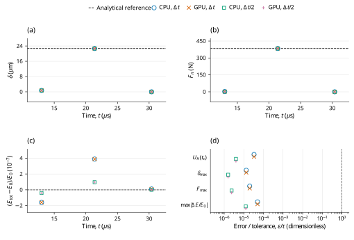

# Material-based Hertz wall collision: LAMMPS benchmark verification

**Case:** `dem03-hertzmaterial-wall`  
**Evidence date:** 28 October 2026  
**Historical outcome:** **PASS**

## Abstract

This study examines elastic sphere–wall Hertz impact with directly prescribed material constants using pinned LAMMPS inputs and analytic assertions. The official sampled energy error decreases from 0.0000332% to 0.0000040% on halving the time step; all four runs satisfy the 1% criterion. CPU and GPU calculations at the original and halved time steps give the historical outcome **PASS**. The measurements are retained campaign evidence; this revision changes their scientific presentation and does not certify a new run of the current core.

## 1. Benchmark definition

The benchmark is defined by the official input and saved reference states [1]; its analytic quantities and acceptance procedure are specified by the official checker [2]. The source commit is `f9720ce2d176d615495d1d6c31349b1f71be1c73` and the input Git blob is `2b1e846a6377f3218c0bc3756e3c430738d12a33`. LAMMPS was not rerun locally. The pinned upstream inputs and their original qualifications are retained.

**Table 1.** Physical configuration, coefficient mapping and integration settings. Values are in SI units except the explicitly mapped reduced-unit input where stated.

| Quantity | Official input / FunDEM mapping |
|---|---|
| One sphere | Diameter 0.005 m; density 7000 kg/m^3 |
| Initial center; velocity | (0, 0, 0.002550) m; (0, 0, -3.9) m/s |
| Initial spin | Zero |
| Fixed plane | z = 0; no translation or rotation |
| Direct material constants | Both sphere and wall: E = 1.0e11 Pa; Poisson ratio = 0.25 |
| Effective elastic contact | E* = E / [2 (1 - nu^2)] = 5.333333333e10 Pa; R* = R = 0.0025 m |
| Restitution; damping; friction | e = 1; all contact damping and friction = 0 |
| Other forces / boundaries | No gravity or global damping; free outer boundaries |
| Base integration | dt = 1e-8 s; 1300 + 838 + 900 = 3038 steps |
| Refined integration | dt = 5e-9 s; 6076 steps; same 30.38 us endpoint |
| Native output | Every integration step, including t = 0 |
| Native material encoding | E = 100000000000 Pa, nu = 0.25, encoded restitution = 1, density = 7000 kg/m^3 |

The native material encoding is reported for reproducibility of the dedicated C++ input; it is not an additional fitted reference parameter. Under explicit Hooke stiffness, E and nu do not set the active spring constants. When manual contact damping is enabled, the encoded material restitution does not set the prescribed dashpot.

The elastic normal force and stored contact energy follow the Hertz law. With reduced mass \(m^*\), approach speed \(V\) and \(K=(4/3)E^*\sqrt{R^*}\), the continuum peak predictions used by the retained analyses are [2]
$$
F_n=K\delta^{3/2},\qquad U(\delta)=\frac{2}{5}K\delta^{5/2}=\frac{2}{5}F_n\delta.
\tag{1a}
$$

$$
\delta_{\max}=\left(\frac{5m^*V^2}{4K}\right)^{2/5},\qquad F_{\max}=K\delta_{\max}^{3/2}.
\tag{1b}
$$


## 2. Numerical method and verification procedure

The retained campaign comprises CPU and GPU calculations at \(\Delta t\) and \(\Delta t/2\). The refined runs use twice as many steps, with unchanged initial conditions and duration. Comparisons are made at equal physical times, using twice the base-step index in the refined runs. The native contact solver supplies the reported motion; the analytic reference is used for comparison, not to generate the native response.

1% force-overlap energy at 21.38 us.

At cumulative step 2138, \(t_c=21.38\,\mu\mathrm{s}\), the official assertion compares \((2/5)|F_n(t_c)|\delta(t_c)\) with \((1/2)mV^2\), using relative limit 0.01. Separate maximum-overlap and peak-force diagnostics are not substituted for this sampled product.

For a native quantity \(q\) and reference \(q_{\rm ref}\), the error definitions are

$$
\varepsilon_{\rm rel}=\frac{|q-q_{\rm ref}|}{|q_{\rm ref}|},\qquad\varepsilon_{\rm abs}=|q-q_{\rm ref}|.
\tag{2}
$$

An error is accepted when it does not exceed its stated limit. Relative errors and limits are dimensionless; percentage columns equal \(100\varepsilon_{\rm rel}\). Absolute errors carry the units of the quantity. Zero-reference assertions use their stated absolute bounds rather than dividing by zero. The analytic tolerances in [1,2], or separately labeled supplemental diagnostic limits, determine acceptance. The YAML same-code regression epsilon is retained as source metadata and is not adopted as a cross-software acceptance tolerance.

## 3. Results and discussion

**Table 2.** Retained measurements for the two backends and two time steps. Numerical values, error types, limits and decisions are reproduced from the campaign record without refitting. `dt` denotes \(\Delta t\), and `dt/2` denotes the refined step; `um` denotes µm where used.

| Run | Max. overlap (um) | Overlap error (%) | Peak force (N) | Force error (%) | Official energy error (%) | Official 1% |
|---|---:|---:|---:|---:|---:|---|
| CPU dt | 22.680647 | 0.0000133 | 384.052517 | 0.0000199 | 0.0000332 | PASS |
| GPU dt | 22.680647 | 0.0000133 | 384.052517 | 0.0000199 | 0.0000332 | PASS |
| CPU dt/2 | 22.680644 | 0.0000016 | 384.052449 | 0.0000024 | 0.0000040 | PASS |
| GPU dt/2 | 22.680644 | 0.0000016 | 384.052449 | 0.0000024 | 0.0000040 | PASS |

The overlap and force errors also decrease, from 0.0000133% to 0.0000016% and from 0.0000199% to 0.0000024%, respectively. These are supplemental peak diagnostics alongside the official sampled energy assertion. The two supplied material moduli reproduce the pinned wall mixing convention; a rigid geometric wall does not mean replacing the specified wall material by an infinite modulus.



**Figure 1.** Retained Hertz-contact measurements for dem03-hertzmaterial-wall. Panels (a) and (b) show contact overlap and normal-force magnitude at the three retained physical checkpoint times for each run. Their black dashed lines denote the continuum analytical maxima $\delta_{\mathrm{max}}$ and $F_{\mathrm{max}}$, not LAMMPS saved-state trajectories. Panel (c) shows signed total-energy drift $(E_{\mathrm{tot}}-E_0)/E_0$, where $E_{\mathrm{tot}}=K+U_H$ and the dashed zero line denotes conservation of the retained initial energy $E_0$. Here $E_0=0.00348422260237\,\mathrm{J}$. Blue open circles, orange crosses, green open squares and purple plus signs denote CPU at $\Delta t$, GPU at $\Delta t$, CPU at $\Delta t/2$ and GPU at $\Delta t/2$, respectively. All numerical checkpoint observations remain unconnected symbols at their original times; overlapping runs are neither averaged nor shifted. Panel (d) shows error divided by its stated limit. The $U_H(t_c)$ row is the official sampled criterion $U_H(t_c)=(2/5)F_n(t_c)\delta(t_c)$ against $E_0$, at $t_c=21.38\,\mu\mathrm{s}$. The $\delta_{\mathrm{max}}$ and $F_{\mathrm{max}}$ rows are separately declared global-peak diagnostics; the final row is the retained whole-event maximum $|\Delta E/E_0|$. Each uses a 0.01 limit; only the first row is the named official energy assertion. Global scalar summaries are read from HISTORICAL-RESULTS.csv, not inferred from the three checkpoints or assigned guessed peak times. The dashed vertical acceptance boundary is error/limit = 1. Exactly 0 zero ratios are displayed at the explicit logarithmic floor 3.96772167983e-07; positive ratios are unchanged. Run markers have fixed vertical offsets within each categorical diagnostic row. These historical measurements preserve the recorded outcome and do not constitute a new simulation or continuous-time validation.

## 4. Conclusions and limitations

All four retained runs satisfy the stated official analytic criteria for the active trajectory. The historical PASS is restricted to those quantities, sample times and model assumptions; it does not certify inactive contact channels or general many-particle behavior.

Both finite material moduli enter the wall compliance. Official acceptance is the sampled energy check, not full contact-law equivalence.

This report reanalyzes the retained 28 October 2026 campaign; no new physical acceptance run is claimed. Distributed CSV checkpoint tables support the reported samples and scalar diagnostics. Full trajectories and native archives remain outside this repository, so the compact tables and figure must not be interpreted as a newly reconstructed complete time history. CPU/GPU agreement and a two-level time-step study are numerical consistency evidence, not independent proof of model equivalence or an asymptotic convergence order.

## References

[1] LAMMPS Development Team. [Official `dem03-hertzmaterial-wall-3d-si.yaml` input and saved reference states](https://github.com/lammps/lammps/blob/f9720ce2d176d615495d1d6c31349b1f71be1c73/unittest/granular/tests/dem03-hertzmaterial-wall-3d-si.yaml), commit `f9720ce2d176d615495d1d6c31349b1f71be1c73`.

[2] LAMMPS Development Team. [Analytic DEM verification models, `test_analytic_models.cpp`](https://github.com/lammps/lammps/blob/f9720ce2d176d615495d1d6c31349b1f71be1c73/unittest/granular/test_analytic_models.cpp), same pinned source revision.

## Appendix A. Reproducibility and evidence

Run from the directory containing `FunDEMBeta/`, after the [family build instructions](../../README.md#build-and-run):

```bash
cmake --build build --target lammps_dem03_hertzmaterial_wall --parallel
build/validation/LAMMPSComparison/lammps_dem03_hertzmaterial_wall --mode cpu --output build/comparisons/dem03-hertzmaterial-wall-cpu
```

Reserve a new output directory for each execution. Repeat with `--mode gpu`, `--half-step`, and their combination to obtain CPU/GPU results at both time steps; the half-step option doubles the step count to preserve duration. GPU execution requires a CUDA-enabled build and compatible device. The current dedicated C++ program provides a reproducible setup, but its completion is not a new acceptance certification. Compare its numerical output independently with the physical quantities, times and limits stated above.

- [Native C++ case](dem03-hertzmaterial-wall.cpp)
- [Exact historical numerical fields](HISTORICAL-RESULTS.csv) · [record guide](HISTORICAL-RESULTS.md)
- [Pinned sources and historical hashes](PROVENANCE.md)
- [Checkpoint: official_checkpoint_comparison.csv](checkpoints/official_checkpoint_comparison.csv)
- [Complete historical report](HISTORICAL-REPORT.md): unchanged campaign calculations, diagnostics, scope and retention detail.
