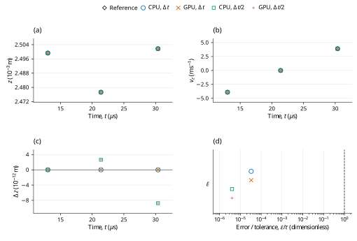

# Legacy Hertz/history wall collision: LAMMPS benchmark verification

**Case:** `dem03-legacy-hertzhistory-wall`  
**Evidence date:** 29 October 2026  
**Historical outcome:** **PASS**

## Abstract

This study examines the elastic normal degeneration of the legacy Hertz/history sphere–wall model using pinned LAMMPS inputs and analytic assertions. The sampled Hertz energy errors are 3.31759077708e-07 and 3.97308116409e-08 at the base and refined steps, below the 0.01 relative limit. CPU and GPU calculations at the original and halved time steps give the historical outcome **PASS**. The measurements are retained campaign evidence; this revision changes their scientific presentation and does not certify a new run of the current core.

## 1. Benchmark definition

The benchmark is defined by the official input and saved reference states [1]; its analytic quantities and acceptance procedure are specified by the official checker [2]. The source commit is `29dd3fd7642a6fe9e8b4dd99120df4068b221250` and the input Git blob is `9b8a5577c5c27f8beacb2402173c0c68df6fb6f8`. LAMMPS was not rerun locally. Upstream qualification: `unvetted`.

**Table 1.** Physical configuration, coefficient mapping and integration settings. Values are in SI units except the explicitly mapped reduced-unit input where stated.

| Quantity | Official input / native representation |
|---|---|
| sphere: initial state | R=0.0025 m; position=(0, 0, 0.00255) m; velocity=(0, 0, -3.9) m/s; spin=(0, 0, 0) rad/s. |
| sphere: mass and inertia | mass=0.000458148928649 kg; isotropic inertia=1.14537232162e-09 kg m^2. |
| Normal elastic law | Hertz Fn_elastic=(4/3)*E_eff*sqrt(R_eff)*delta^1.5; native E_eff=5.3333325e+10 Pa. Stored linear kn is inactive. |
| Damping convention | Automatic damping uses the harmonic material restitution and the active normal/tangential stiffness; stored manual dashpots are inactive. |
| Tangential parameters | kt=0 N/m (explicit in linear mode), mu=0 |
| Rolling and twisting parameters | kr=0, mu_r=0, ktwist=0, mu_twist=0 |
| Gravity | (0, 0, 0)m/s^2 |
| Base / refined time step (s) | 1e-08/5e-09 |
| Base / refined integration steps | 3038/6076 |
| Native material encoding | E = 99999984375 Pa, nu = 0.25, encoded restitution = 1, density = 7000 kg/m^3 |

The native material encoding is reported for reproducibility of the dedicated C++ input; it is not an additional fitted reference parameter. Under explicit Hooke stiffness, E and nu do not set the active spring constants. When manual contact damping is enabled, the encoded material restitution does not set the prescribed dashpot.

- Legacy Hertz zero normal damping maps to native e1 and E*=3kn/4. The source NULL tangential Hertz stiffness is dormant because relative tangential velocity is identically zero. This verifies only the normal degeneration.

The elastic normal force and stored contact energy follow the Hertz law. With reduced mass \(m^*\), approach speed \(V\) and \(K=(4/3)E^*\sqrt{R^*}\), the continuum peak predictions used by the retained analyses are [2]
$$
F_n=K\delta^{3/2},\qquad U(\delta)=\frac{2}{5}K\delta^{5/2}=\frac{2}{5}F_n\delta.
\tag{1a}
$$

$$
\delta_{\max}=\left(\frac{5m^*V^2}{4K}\right)^{2/5},\qquad F_{\max}=K\delta_{\max}^{3/2}.
\tag{1b}
$$


## 2. Numerical method and verification procedure

The retained campaign comprises CPU and GPU calculations at \(\Delta t\) and \(\Delta t/2\). The refined runs use twice as many steps, with unchanged initial conditions and duration. Comparisons are made at equal physical times, using twice the base-step index in the refined runs. The native contact solver supplies the reported motion; the analytic reference is used for comparison, not to generate the native response.

Model `hertz_normal_impact` is evaluated at original step 2138 and time 2.138e-05s. Half-step runs use twice the native check step at the same physical time. The exact reference, relative/absolute error type and unchanged limit are listed separately for each quantity. Whole histories and source golden states supplement these selected-time assertions.

For a native quantity \(q\) and reference \(q_{\rm ref}\), the error definitions are

$$
\varepsilon_{\rm rel}=\frac{|q-q_{\rm ref}|}{|q_{\rm ref}|},\qquad\varepsilon_{\rm abs}=|q-q_{\rm ref}|.
\tag{2}
$$

An error is accepted when it does not exceed its stated limit. Relative errors and limits are dimensionless; percentage columns equal \(100\varepsilon_{\rm rel}\). Absolute errors carry the units of the quantity. Zero-reference assertions use their stated absolute bounds rather than dividing by zero. The analytic tolerances in [1,2], or separately labeled supplemental diagnostic limits, determine acceptance. The YAML same-code regression epsilon is retained as source metadata and is not adopted as a cross-software acceptance tolerance.

## 3. Results and discussion

**Table 2.** Retained measurements for the two backends and two time steps. Numerical values, error types, limits and decisions are reproduced from the campaign record without refitting. `dt` denotes \(\Delta t\), and `dt/2` denotes the refined step; `um` denotes µm where used.

| Run | Quantity | Reference | Native value | Error type | Error | Limit | Result |
|---|---|---:|---:|---|---:|---:|---|
| CPU dt | Hertz peak energy (J) | 0.00348422260237 | 0.00348422375829 | relative | 3.31759077708e-07 | 0.01 | PASS |
| GPU dt | Hertz peak energy (J) | 0.00348422260237 | 0.00348422375829 | relative | 3.31759077708e-07 | 0.01 | PASS |
| CPU dt/2 | Hertz peak energy (J) | 0.00348422260237 | 0.0034842227408 | relative | 3.97308116409e-08 | 0.01 | PASS |
| GPU dt/2 | Hertz peak energy (J) | 0.00348422260237 | 0.0034842227408 | relative | 3.97308116409e-08 | 0.01 | PASS |

The sampled contact energy approaches the reference 0.00348422260237 J on refinement. Zero normal damping maps to e = 1, and the legacy tangential Hertz defaults are dormant because tangential relative velocity is zero. The historical PASS is restricted to normal elastic wall impact and does not demonstrate an active history, friction or damping model.



**Figure 1.** Historical checkpoint comparison for dem03-legacy-hertzhistory-wall. Panels (a) and (b) show position (z component) and velocity (z component) of the selected body 'sphere'; (c) shows the signed FunDEM-minus-reference residual of (a). Black open diamonds denote pinned LAMMPS saved-state references; blue open circles, orange crosses, green open squares and purple plus signs denote CPU at Δt, GPU at Δt, CPU at Δt/2 and GPU at Δt/2, respectively. Every run uses its retained physical checkpoint times; no time shift, jitter, averaging, fitting or connecting trajectory is used. Coincident symbols are retained with different shapes and sizes. Axes state physical units and explicit powers of ten. Panel (d) shows recomputed error divided by its stated tolerance; the dashed vertical line is the acceptance boundary ε/τ = 1. Absolute errors are |actual−expected|; relative errors divide this by |expected|. Hertz peak energy (J): relative tolerance 0.01. Exactly 0 zero ratios are displayed at the explicit logarithmic floor 9.93270291023e-07; every positive ratio is unmodified. The four run markers have deterministic vertical offsets within each categorical criterion row solely to distinguish coincident values. These sparse historical checkpoints do not establish a new validation outcome for the current source or a continuous-time error bound.

## 4. Conclusions and limitations

All four retained runs satisfy the stated official analytic criteria for the active trajectory. The historical PASS is restricted to those quantities, sample times and model assumptions; it does not certify inactive contact channels or general many-particle behavior.

Zero normal damping and zero slip isolate normal elastic response; active tangential history is not tested.

This report reanalyzes the retained 29 October 2026 campaign; no new physical acceptance run is claimed. Distributed CSV checkpoint tables support the reported samples and scalar diagnostics. Full trajectories and native archives remain outside this repository, so the compact tables and figure must not be interpreted as a newly reconstructed complete time history. CPU/GPU agreement and a two-level time-step study are numerical consistency evidence, not independent proof of model equivalence or an asymptotic convergence order.

## References

[1] LAMMPS Development Team. [Official `dem03-legacy-hertzhistory-wall-3d-si.yaml` input and saved reference states](https://github.com/lammps/lammps/blob/29dd3fd7642a6fe9e8b4dd99120df4068b221250/unittest/granular/tests/dem03-legacy-hertzhistory-wall-3d-si.yaml), commit `29dd3fd7642a6fe9e8b4dd99120df4068b221250`.

[2] LAMMPS Development Team. [Analytic DEM verification models, `test_analytic_models.cpp`](https://github.com/lammps/lammps/blob/29dd3fd7642a6fe9e8b4dd99120df4068b221250/unittest/granular/test_analytic_models.cpp), same pinned source revision.

## Appendix A. Reproducibility and evidence

Run from the directory containing `FunDEMBeta/`, after the [family build instructions](../../README.md#build-and-run):

```bash
cmake --build build --target lammps_dem03_legacy_hertzhistory_wall --parallel
build/validation/LAMMPSComparison/lammps_dem03_legacy_hertzhistory_wall --mode cpu --output build/comparisons/dem03-legacy-hertzhistory-wall-cpu
```

Reserve a new output directory for each execution. Repeat with `--mode gpu`, `--half-step`, and their combination to obtain CPU/GPU results at both time steps; the half-step option doubles the step count to preserve duration. GPU execution requires a CUDA-enabled build and compatible device. The current dedicated C++ program provides a reproducible setup, but its completion is not a new acceptance certification. Compare its numerical output independently with the physical quantities, times and limits stated above.

- [Native C++ case](dem03-legacy-hertzhistory-wall.cpp)
- [Exact historical numerical fields](HISTORICAL-RESULTS.csv) · [record guide](HISTORICAL-RESULTS.md)
- [Pinned sources and historical hashes](PROVENANCE.md)
- [Checkpoint: official_metrics_comparison.csv](checkpoints/official_metrics_comparison.csv)
- [Checkpoint: source_checkpoint_comparison.csv](checkpoints/source_checkpoint_comparison.csv)
- [Complete historical report](HISTORICAL-REPORT.md): unchanged campaign calculations, diagnostics, scope and retention detail.
