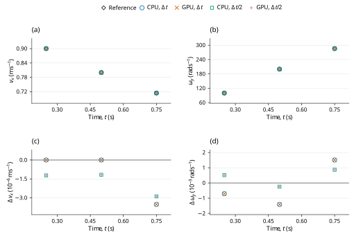

# Hooke sliding to rolling: LAMMPS benchmark verification

**Case:** `dem05-hookehistory-slip`  
**Evidence date:** 28 October 2026  
**Historical outcome:** **PASS**

## Abstract

This study examines Coulomb deceleration, spin-up and the approach to rolling for a sphere on a Hooke/history plane using pinned LAMMPS inputs and analytic assertions. At 0.75 s, base-step v_x and ω_y errors are 0.006847% and 0.016411%, within the official 1% limits. CPU and GPU calculations at the original and halved time steps give the historical outcome **PASS**. The measurements are retained campaign evidence; this revision changes their scientific presentation and does not certify a new run of the current core.

## 1. Benchmark definition

The benchmark is defined by the official input and saved reference states [1]; its analytic quantities and acceptance procedure are specified by the official checker [2]. The source commit is `f9720ce2d176d615495d1d6c31349b1f71be1c73` and the input Git blob is `9d4f2bbc7cf3aa5c10728a2cb2e90cbce024fa91`. LAMMPS was not rerun locally. The pinned upstream inputs and their original qualifications are retained.

**Table 1.** Physical configuration, coefficient mapping and integration settings. Values are in SI units except the explicitly mapped reduced-unit input where stated.

| Quantity | Official input / FunDEM mapping |
|---|---|
| Sphere | Radius 0.0025 m; density 2700 kg/m^3 |
| Mass; moment of inertia | 0.000176714586764 kg; 4.41786466911e-10 kg m^2 |
| Initial center | (0, 0, 0.002499982) m |
| Initial translation; rotation | vx = 1 m/s; zero spin |
| Floor; upper plane | z = 0 m; z = 1 m, inactive |
| Gravity | (0, 0, -1) m/s^2 |
| Normal law | Hooke; kn = 10000 N/m |
| Tangential law | Linear history; kt = 2800 N/m; sliding friction = 0.4 |
| Damping | Restitution = 1; normal and tangential damping = 0 |
| Other dissipation | Rolling/torsional friction and global damping = 0 |
| Official time step / segments | 1e-5 s; 25000 + 25000 + 25000 steps |
| Refined time step | 5e-6 s; 150000 steps; same 0.75 s endpoint |
| Native output | Every 1 ms, including both endpoints; 751 frames per run |
| Detailed CSV output | Every integration step, separately from native result frames |
| Official periodic box | x: [-0.05, 0.5] m; y: [-0.05, 0.05] m |
| Native material encoding | E = 10000 Pa, nu = 0.33, encoded restitution = 1, density = 2700 kg/m^3 |

The native material encoding is reported for reproducibility of the dedicated C++ input; it is not an additional fitted reference parameter. Under explicit Hooke stiffness, E and nu do not set the active spring constants. When manual contact damping is enabled, the encoded material restitution does not set the prescribed dashpot.

For a solid sphere, \(I=(2/5)mR^2\). The official nominal-radius Coulomb model predicts the ideal slip-cessation time and subsequent rolling state [2]:
$$
t_s=\frac{2u_0}{7\mu g},\qquad u_f=\frac{5}{7}u_0,\qquad\omega_{y,f}=\frac{u_f}{R}.
\tag{1}
$$

The two endpoint quantities are tested independently. This model assumes the nominal radius \(R\) in the no-slip relation; the native geometric arm can differ at finite overlap.

## 2. Numerical method and verification procedure

The retained campaign comprises CPU and GPU calculations at \(\Delta t\) and \(\Delta t/2\). The refined runs use twice as many steps, with unchanged initial conditions and duration. Comparisons are made at equal physical times, using twice the base-step index in the refined runs. The native contact solver supplies the reported motion; the analytic reference is used for comparison, not to generate the native response.

1% final vx and omega_y at 0.75 s.

The independent endpoint targets are \(u_f=0.714285714286\,\mathrm{m/s}\) and \(\omega_{y,f}=285.714285714\,\mathrm{rad/s}\). Each has relative limit 0.01. The transition time is a diagnostic and is not itself the official acceptance assertion.

For a native quantity \(q\) and reference \(q_{\rm ref}\), the error definitions are

$$
\varepsilon_{\rm rel}=\frac{|q-q_{\rm ref}|}{|q_{\rm ref}|},\qquad\varepsilon_{\rm abs}=|q-q_{\rm ref}|.
\tag{2}
$$

An error is accepted when it does not exceed its stated limit. Relative errors and limits are dimensionless; percentage columns equal \(100\varepsilon_{\rm rel}\). Absolute errors carry the units of the quantity. Zero-reference assertions use their stated absolute bounds rather than dividing by zero. The analytic tolerances in [1,2], or separately labeled supplemental diagnostic limits, determine acceptance. The YAML same-code regression epsilon is retained as source metadata and is not adopted as a cross-software acceptance tolerance.

## 3. Results and discussion

**Table 2.** Retained measurements for the two backends and two time steps. Numerical values, error types, limits and decisions are reproduced from the campaign record without refitting. `dt` denotes \(\Delta t\), and `dt/2` denotes the refined step; `um` denotes µm where used.

| Run | dt (us) | Final vx (m/s) | vx error (%) | Final omega_y (rad/s) | omega error (%) | Both 1% checks |
|---|---:|---:|---:|---:|---:|---|
| CPU dt | 10 | 0.714236806 | 0.006847 | 285.761175 | 0.016411 | PASS |
| GPU dt | 10 | 0.714236805 | 0.006847 | 285.761175 | 0.016411 | PASS |
| CPU dt/2 | 5 | 0.714237445 | 0.006758 | 285.760535 | 0.016187 | PASS |
| GPU dt/2 | 5 | 0.714237445 | 0.006758 | 285.760535 | 0.016187 | PASS |

At the half step, the errors are 0.006758% and 0.016187%. The values are close to the nominal-radius rolling targets, 5/7 m/s and (5/7)/R rad/s, and CPU/GPU results agree at the reported precision. The small overlap makes the R versus R − δ convention minor here; the PASS does not establish that the two conventions are generally interchangeable. The final-value assertion does not itself measure the exact slip-cessation time or prove sustained zero slip.



**Figure 1.** Historical checkpoint comparison for dem05-hookehistory-slip. Panels (a) and (b) show velocity (x component) and angular velocity (y component) of the selected body 'sphere'; (c) shows the signed FunDEM-minus-reference residual of (a). Black open diamonds denote pinned LAMMPS saved-state references; blue open circles, orange crosses, green open squares and purple plus signs denote CPU at Δt, GPU at Δt, CPU at Δt/2 and GPU at Δt/2, respectively. Every run uses its retained physical checkpoint times; no time shift, jitter, averaging, fitting or connecting trajectory is used. Coincident symbols are retained with different shapes and sizes. Axes state physical units and explicit powers of ten. Panel (d) shows the signed residual of (b). Both residual panels use linear scales, with zero shown at its true ordinate. These sparse historical checkpoints do not establish a new validation outcome for the current source or a continuous-time error bound.

## 4. Conclusions and limitations

All four retained runs satisfy the stated official analytic criteria for the active trajectory. The historical PASS is restricted to those quantities, sample times and model assumptions; it does not certify inactive contact channels or general many-particle behavior.

Endpoint translation and spin are tested with zero tangential damping. Rolling resistance and torsion are inactive.

This report reanalyzes the retained 28 October 2026 campaign; no new physical acceptance run is claimed. Distributed CSV checkpoint tables support the reported samples and scalar diagnostics. Full trajectories and native archives remain outside this repository, so the compact tables and figure must not be interpreted as a newly reconstructed complete time history. CPU/GPU agreement and a two-level time-step study are numerical consistency evidence, not independent proof of model equivalence or an asymptotic convergence order.

## References

[1] LAMMPS Development Team. [Official `dem05-hookehistory-slip-3d-si.yaml` input and saved reference states](https://github.com/lammps/lammps/blob/f9720ce2d176d615495d1d6c31349b1f71be1c73/unittest/granular/tests/dem05-hookehistory-slip-3d-si.yaml), commit `f9720ce2d176d615495d1d6c31349b1f71be1c73`.

[2] LAMMPS Development Team. [Analytic DEM verification models, `test_analytic_models.cpp`](https://github.com/lammps/lammps/blob/f9720ce2d176d615495d1d6c31349b1f71be1c73/unittest/granular/test_analytic_models.cpp), same pinned source revision.

## Appendix A. Reproducibility and evidence

Run from the directory containing `FunDEMBeta/`, after the [family build instructions](../../README.md#build-and-run):

```bash
cmake --build build --target lammps_dem05_hookehistory_slip --parallel
build/validation/LAMMPSComparison/lammps_dem05_hookehistory_slip --mode cpu --output build/comparisons/dem05-hookehistory-slip-cpu
```

Reserve a new output directory for each execution. Repeat with `--mode gpu`, `--half-step`, and their combination to obtain CPU/GPU results at both time steps; the half-step option doubles the step count to preserve duration. GPU execution requires a CUDA-enabled build and compatible device. The current dedicated C++ program provides a reproducible setup, but its completion is not a new acceptance certification. Compare its numerical output independently with the physical quantities, times and limits stated above.

- [Native C++ case](dem05-hookehistory-slip.cpp)
- [Exact historical numerical fields](HISTORICAL-RESULTS.csv) · [record guide](HISTORICAL-RESULTS.md)
- [Pinned sources and historical hashes](PROVENANCE.md)
- [Checkpoint: official_checkpoint_comparison.csv](checkpoints/official_checkpoint_comparison.csv)
- [Complete historical report](HISTORICAL-REPORT.md): unchanged campaign calculations, diagnostics, scope and retention detail.
