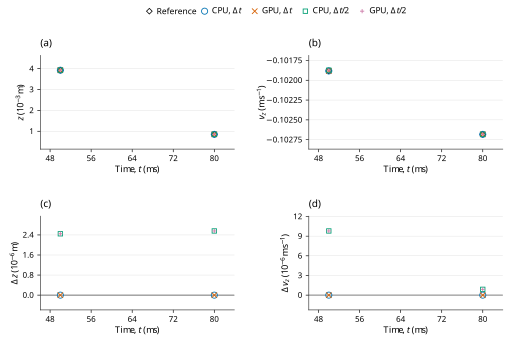

# Linear viscous drag: LAMMPS benchmark verification

**Case:** `dem09-viscous-linear`  
**Evidence date:** 29 October 2026  
**Historical outcome:** **PASS**

## Abstract

This study examines particle acceleration under gravity and linear external drag using pinned LAMMPS inputs and analytic assertions. The terminal-speed assertion at 0.08 s has relative errors 0.0463769% and 0.0472380% at the base and half steps, within the official 0.5% limit. CPU and GPU calculations at the original and halved time steps give the historical outcome **PASS**. The measurements are retained campaign evidence; this revision changes their scientific presentation and does not certify a new run of the current core.

## 1. Benchmark definition

The benchmark is defined by the official input and saved reference states [1]; its analytic quantities and acceptance procedure are specified by the official checker [2]. The source commit is `29dd3fd7642a6fe9e8b4dd99120df4068b221250` and the input Git blob is `c1948eb56cac61f1c6159fc060d7d191c1ab897c`. LAMMPS was not rerun locally. The pinned upstream input is tagged `unvetted`; the comparison does not remove that qualification.

**Table 1.** Physical configuration, coefficient mapping and integration settings. Values are in SI units except the explicitly mapped reduced-unit input where stated.

| Quantity | Official / native value |
|---|---|
| Particle | R=5e-5 m, density=2000 kg/m^3; m=1.0471975512e-09 kg |
| Initial state | Center=(0,0,0.008) m; zero velocity and spin |
| Gravity | (0,0,-9.81) m/s^2 throughout |
| External viscous drag | F_drag=-gamma v; gamma=1e-7 kg/s |
| Native particle-damping module | dampingRate=gamma/m=95.4929658551 1/s; target sphere; rotationalDragCoefficient=0 |
| Contacts / other forces | No contacts, walls, other particles or active SPH forces; inactive contact-material fields do not set the drag |
| Time | Official dt=1e-4 s; 500+300=800 steps to 0.08 s. Half-step=5e-5 s; 1600 steps |
| Full native outputs | Every numerical step including t=0: 801/801/1601/1601 frames, total 4804 |
| Native material encoding | E = 10000 Pa, nu = 0.33, encoded restitution = 1, density = 2000 kg/m^3 |

The native material encoding is reported for reproducibility of the dedicated C++ input; it is not an additional fitted reference parameter. Under explicit Hooke stiffness, E and nu do not set the active spring constants. When manual contact damping is enabled, the encoded material restitution does not set the prescribed dashpot.

With upward \(z\) and positive falling speed \(w=-v_z\), the external force balance and its continuous solution from rest are
$$
m\dot w=mg-\gamma w,\qquad w_\infty=\frac{mg}{\gamma},\qquad w(t)=w_\infty\left(1-e^{-\gamma t/m}\right).
\tag{1}
$$

The official checker [2] compares the finite-time sampled speed to \(w_\infty\), not to the finite-time exponential expression.

## 2. Numerical method and verification procedure

The retained campaign comprises CPU and GPU calculations at \(\Delta t\) and \(\Delta t/2\). The refined runs use twice as many steps, with unchanged initial conditions and duration. Comparisons are made at equal physical times, using twice the base-step index in the refined runs. The native contact solver supplies the reported motion; the analytic reference is used for comparison, not to generate the native response.

0.5% relative terminal-speed assertion at 0.08 s: compare -vz with m*g/gamma (official tag unvetted).

For a native quantity \(q\) and reference \(q_{\rm ref}\), the error definitions are

$$
\varepsilon_{\rm rel}=\frac{|q-q_{\rm ref}|}{|q_{\rm ref}|},\qquad\varepsilon_{\rm abs}=|q-q_{\rm ref}|.
\tag{2}
$$

An error is accepted when it does not exceed its stated limit. Relative errors and limits are dimensionless; percentage columns equal \(100\varepsilon_{\rm rel}\). Absolute errors carry the units of the quantity. Zero-reference assertions use their stated absolute bounds rather than dividing by zero. The analytic tolerances in [1,2], or separately labeled supplemental diagnostic limits, determine acceptance. The YAML same-code regression epsilon is retained as source metadata and is not adopted as a cross-software acceptance tolerance.

## 3. Results and discussion

**Table 2.** Retained measurements for the two backends and two time steps. Numerical values, error types, limits and decisions are reproduced from the campaign record without refitting. `dt` denotes \(\Delta t\), and `dt/2` denotes the refined step; `um` denotes µm where used.

| Run | Final falling speed -vz (m/s) | Official relative error (%) | Final z (m) | Official 0.5% assertion |
|---|---:|---:|---:|---|
| CPU dt | 0.10268243674 | 0.0463769 | 0.0008517475 | PASS |
| GPU dt | 0.10268243674 | 0.0463769 | 0.0008517475 | PASS |
| CPU dt/2 | 0.10268155218 | 0.0472380 | 0.0008543053 | PASS |
| GPU dt/2 | 0.10268155218 | 0.0472380 | 0.0008543053 | PASS |

The asserted reference is the asymptotic speed mg/γ, although the sampled solution is at finite time. Consequently, a smaller integration error need not reduce the distance to that asymptote monotonically. The final speeds are 0.10268243674 and 0.10268155218 m/s. This is an external-drag test without contacts; inactive material coefficients provide no evidence for contact damping. The pinned upstream `unvetted` qualification remains applicable.



**Figure 1.** Historical checkpoint comparison for dem09-viscous-linear. Panels (a) and (b) show position (z component) and velocity (z component) of the selected body 'sphere'; (c) shows the signed FunDEM-minus-reference residual of (a). Black open diamonds denote pinned LAMMPS saved-state references; blue open circles, orange crosses, green open squares and purple plus signs denote CPU at Δt, GPU at Δt, CPU at Δt/2 and GPU at Δt/2, respectively. Every run uses its retained physical checkpoint times; no time shift, jitter, averaging, fitting or connecting trajectory is used. Coincident symbols are retained with different shapes and sizes. Axes state physical units and explicit powers of ten. Panel (d) shows the signed residual of (b). Both residual panels use linear scales, with zero shown at its true ordinate. These sparse historical checkpoints do not establish a new validation outcome for the current source or a continuous-time error bound.

## 4. Conclusions and limitations

All four retained runs satisfy the stated official analytic criteria for the active trajectory. The historical PASS is restricted to those quantities, sample times and model assumptions; it does not certify inactive contact channels or general many-particle behavior.

The official criterion compares finite-endpoint speed with the asymptotic terminal target. No contacts are active; finite-time analytic errors are supplemental.

This report reanalyzes the retained 29 October 2026 campaign; no new physical acceptance run is claimed. Distributed CSV checkpoint tables support the reported samples and scalar diagnostics. Full trajectories and native archives remain outside this repository, so the compact tables and figure must not be interpreted as a newly reconstructed complete time history. CPU/GPU agreement and a two-level time-step study are numerical consistency evidence, not independent proof of model equivalence or an asymptotic convergence order.

## References

[1] LAMMPS Development Team. [Official `dem09-viscous-linear-3d-si.yaml` input and saved reference states](https://github.com/lammps/lammps/blob/29dd3fd7642a6fe9e8b4dd99120df4068b221250/unittest/granular/tests/dem09-viscous-linear-3d-si.yaml), commit `29dd3fd7642a6fe9e8b4dd99120df4068b221250`.

[2] LAMMPS Development Team. [Analytic DEM verification models, `test_analytic_models.cpp`](https://github.com/lammps/lammps/blob/29dd3fd7642a6fe9e8b4dd99120df4068b221250/unittest/granular/test_analytic_models.cpp), same pinned source revision.

## Appendix A. Reproducibility and evidence

Run from the directory containing `FunDEMBeta/`, after the [family build instructions](../../README.md#build-and-run):

```bash
cmake --build build --target lammps_dem09_viscous_linear --parallel
build/validation/LAMMPSComparison/lammps_dem09_viscous_linear --mode cpu --output build/comparisons/dem09-viscous-linear-cpu
```

Reserve a new output directory for each execution. Repeat with `--mode gpu`, `--half-step`, and their combination to obtain CPU/GPU results at both time steps; the half-step option doubles the step count to preserve duration. GPU execution requires a CUDA-enabled build and compatible device. The current dedicated C++ program provides a reproducible setup, but its completion is not a new acceptance certification. Compare its numerical output independently with the physical quantities, times and limits stated above.

- [Native C++ case](dem09-viscous-linear.cpp)
- [Exact historical numerical fields](HISTORICAL-RESULTS.csv) · [record guide](HISTORICAL-RESULTS.md)
- [Pinned sources and historical hashes](PROVENANCE.md)
- [Checkpoint: official_checkpoint_comparison.csv](checkpoints/official_checkpoint_comparison.csv)
- [Complete historical report](HISTORICAL-REPORT.md): unchanged campaign calculations, diagnostics, scope and retention detail.
