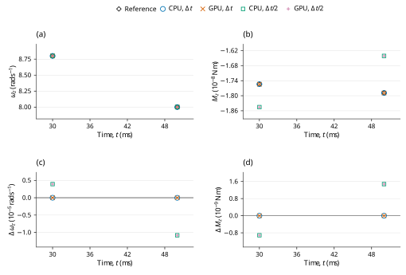

# SDS torsional resistance: LAMMPS benchmark verification

**Case:** `dem13-twist-sds`  
**Evidence date:** 28 October 2026  
**Historical outcome:** **PASS**

## Abstract

This study examines saturated spring–dashpot–slider twisting torque and decay of spin about the contact normal using pinned LAMMPS inputs and analytic assertions. At 30 ms, base-step and refined spins are 8.7999300953 and 8.7999340255 rad/s against the official 8.8 rad/s target, within 1%. CPU and GPU calculations at the original and halved time steps give the historical outcome **PASS**. The measurements are retained campaign evidence; this revision changes their scientific presentation and does not certify a new run of the current core.

## 1. Benchmark definition

The benchmark is defined by the official input and saved reference states [1]; its analytic quantities and acceptance procedure are specified by the official checker [2]. The source commit is `29dd3fd7642a6fe9e8b4dd99120df4068b221250` and the input Git blob is `a6b317c73f34232186ceb3207a9422c02686f657`. LAMMPS was not rerun locally. The pinned upstream input is tagged `unvetted`; the comparison does not remove that qualification.

**Table 1.** Physical configuration, coefficient mapping and integration settings. Values are in SI units except the explicitly mapped reduced-unit input where stated.

| Quantity | Official input / FunDEM configuration |
|---|---|
| Sphere diameter; density | 0.005 m; 2700 kg/m^3 |
| Mass; solid-sphere inertia | 0.000176714586764 kg; 4.41786466911e-10 kg m^2 |
| Initial center; translation | (0, 0, 0.0024999998) m; v = 0 |
| Initial spin | (0, 0, 10) rad/s, about the contact normal |
| Wall; gravity | Fixed plane z = 0; g = 1 m/s^2 downward |
| Normal and sliding | Hooke kn = 1e6 N/m; linear_history ks = 2.8e5 N/m; sliding friction = 0.5 |
| Restitution; other channels | e = 1; normal/sliding/rolling/global damping = 0; rolling friction = 0 |
| Official twisting SDS | angular stiffness Ktw = 1 N m/rad; damping Ctw = 1e-6 N m s/rad; torque-cap length mut = 1e-4 m |
| FunDEM torsional parameters | ktorsion = 40000 N/m; ctorsion = 0.04 N s/m; torsional friction = 0.02 |
| Time and output | dt = 1e-6 / 5e-7 s; 50000 / 100000 steps; 50 ms endpoint |
| Full native result | Every 10 us including t = 0; 5001 frames per run |
| Detailed trajectory | Every integration step in CSV |
| Native material encoding | E = 10000 Pa, nu = 0.33, encoded restitution = 1, density = 2700 kg/m^3 |

The native material encoding is reported for reproducibility of the dedicated C++ input; it is not an additional fitted reference parameter. Under explicit Hooke stiffness, E and nu do not set the active spring constants. When manual contact damping is enabled, the encoded material restitution does not set the prescribed dashpot.

Writing \(\ell_t\) for the dimensional source torque-cap coefficient, the saturated torque and constant-load spin reference are [2]
$$
M_z=-\ell_tF_n,\qquad I=\frac{2}{5}mR^2,\qquad\omega_z(t)=\omega_0-\frac{\ell_tmg}{I}t.
\tag{1}
$$

For \(D=2R\), the parameter conversion is \(K_{tw}=k_{torsion}D^2\), \(C_{tw}=c_{torsion}D^2\) and \(\ell_t=\mu_{torsion}D\). The source coefficient \(\ell_t\) is a length; native \(\mu_{torsion}\) is dimensionless.

## 2. Numerical method and verification procedure

The retained campaign comprises CPU and GPU calculations at \(\Delta t\) and \(\Delta t/2\). The refined runs use twice as many steps, with unchanged initial conditions and duration. Comparisons are made at equal physical times, using twice the base-step index in the refined runs. The native contact solver supplies the reported motion; the analytic reference is used for comparison, not to generate the native response.

1% omega_z at 30 ms (official input tagged unvetted).

The official `twist_decay` target is \(\omega_z(30\,\mathrm{ms})=8.8\,\mathrm{rad/s}\) with relative limit 0.01, at cumulative step 30000. The 50 ms endpoint is supplementary.

For a native quantity \(q\) and reference \(q_{\rm ref}\), the error definitions are

$$
\varepsilon_{\rm rel}=\frac{|q-q_{\rm ref}|}{|q_{\rm ref}|},\qquad\varepsilon_{\rm abs}=|q-q_{\rm ref}|.
\tag{2}
$$

An error is accepted when it does not exceed its stated limit. Relative errors and limits are dimensionless; percentage columns equal \(100\varepsilon_{\rm rel}\). Absolute errors carry the units of the quantity. Zero-reference assertions use their stated absolute bounds rather than dividing by zero. The analytic tolerances in [1,2], or separately labeled supplemental diagnostic limits, determine acceptance. The YAML same-code regression epsilon is retained as source metadata and is not adopted as a cross-software acceptance tolerance.

## 3. Results and discussion

**Table 2.** Retained measurements for the two backends and two time steps. Numerical values, error types, limits and decisions are reproduced from the campaign record without refitting. `dt` denotes \(\Delta t\), and `dt/2` denotes the refined step; `um` denotes µm where used.

| Run | dt (s) | Steps / native frames | omega_z at 30 ms (rad/s) | Official error (%) | omega_z at 50 ms (rad/s) | 1% check |
|---|---:|---:|---:|---:|---:|---|
| CPU dt | 1e-06 | 50,000 / 5,001 | 8.7999300953 | 0.000794 | 8.0000697065 | PASS |
| GPU dt | 1e-06 | 50,000 / 5,001 | 8.7999300953 | 0.000794 | 8.0000697065 | PASS |
| CPU dt/2 | 5e-07 | 100,000 / 5,001 | 8.7999340255 | 0.000750 | 8.0000589191 | PASS |
| GPU dt/2 | 5e-07 | 100,000 / 5,001 | 8.7999340255 | 0.000750 | 8.0000589191 | PASS |

The official errors decrease from 0.000794% to 0.000750%. The nonzero specified torsional dashpot is retained by the dimensional mapping, but this trajectory remains saturated with positive spin. The archived instantaneous torque-cap residual is at most 1.87e-16 when normalized by the ideal load torque; angular-momentum closure is within 2.99e-22 N m s. The 0.2 nm initial overlap leaves about ±13.177% normal-load oscillation, which the actual torque follows. General spring/dashpot limiting differs between the source and native implementations; this capped-path PASS does not establish uncapped or reversal equivalence. The 50 ms endpoint remains supplementary.



**Figure 1.** Historical checkpoint comparison for dem13-twist-sds. Panels (a) and (b) show angular velocity (z component) and torque (z component) of the selected body 'sphere'; (c) shows the signed FunDEM-minus-reference residual of (a). Black open diamonds denote pinned LAMMPS saved-state references; blue open circles, orange crosses, green open squares and purple plus signs denote CPU at Δt, GPU at Δt, CPU at Δt/2 and GPU at Δt/2, respectively. Every run uses its retained physical checkpoint times; no time shift, jitter, averaging, fitting or connecting trajectory is used. Coincident symbols are retained with different shapes and sizes. Axes state physical units and explicit powers of ten. Panel (d) shows the signed residual of (b). Both residual panels use linear scales, with zero shown at its true ordinate. These sparse historical checkpoints do not establish a new validation outcome for the current source or a continuous-time error bound.

## 4. Conclusions and limitations

All four retained runs satisfy the stated official analytic criteria for the active trajectory. The historical PASS is restricted to those quantities, sample times and model assumptions; it does not certify inactive contact channels or general many-particle behavior.

Only the saturated positive-spin torque/decay path is checked. General uncapped elasticity, dashpot sharing, reversals and Marshall torsion are not validated.

This report reanalyzes the retained 28 October 2026 campaign; no new physical acceptance run is claimed. Distributed CSV checkpoint tables support the reported samples and scalar diagnostics. Full trajectories and native archives remain outside this repository, so the compact tables and figure must not be interpreted as a newly reconstructed complete time history. CPU/GPU agreement and a two-level time-step study are numerical consistency evidence, not independent proof of model equivalence or an asymptotic convergence order.

## References

[1] LAMMPS Development Team. [Official `dem13-twist-sds-3d-si.yaml` input and saved reference states](https://github.com/lammps/lammps/blob/29dd3fd7642a6fe9e8b4dd99120df4068b221250/unittest/granular/tests/dem13-twist-sds-3d-si.yaml), commit `29dd3fd7642a6fe9e8b4dd99120df4068b221250`.

[2] LAMMPS Development Team. [Analytic DEM verification models, `test_analytic_models.cpp`](https://github.com/lammps/lammps/blob/29dd3fd7642a6fe9e8b4dd99120df4068b221250/unittest/granular/test_analytic_models.cpp), same pinned source revision.

## Appendix A. Reproducibility and evidence

Run from the directory containing `FunDEMBeta/`, after the [family build instructions](../../README.md#build-and-run):

```bash
cmake --build build --target lammps_dem13_twist_sds --parallel
build/validation/LAMMPSComparison/lammps_dem13_twist_sds --mode cpu --output build/comparisons/dem13-twist-sds-cpu
```

Reserve a new output directory for each execution. Repeat with `--mode gpu`, `--half-step`, and their combination to obtain CPU/GPU results at both time steps; the half-step option doubles the step count to preserve duration. GPU execution requires a CUDA-enabled build and compatible device. The current dedicated C++ program provides a reproducible setup, but its completion is not a new acceptance certification. Compare its numerical output independently with the physical quantities, times and limits stated above.

- [Native C++ case](dem13-twist-sds.cpp)
- [Exact historical numerical fields](HISTORICAL-RESULTS.csv) · [record guide](HISTORICAL-RESULTS.md)
- [Pinned sources and historical hashes](PROVENANCE.md)
- [Checkpoint: official_checkpoint_comparison.csv](checkpoints/official_checkpoint_comparison.csv)
- [Complete historical report](HISTORICAL-REPORT.md): unchanged campaign calculations, diagnostics, scope and retention detail.
