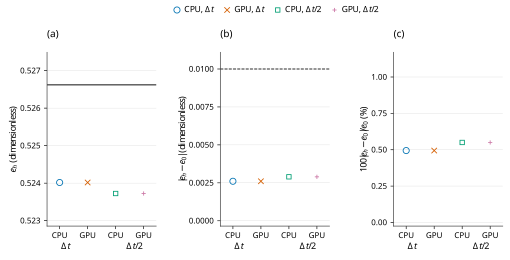

# Linear normal restitution at damping ratio $\beta_n=0.2$

## Abstract

This report evaluates the normal spring–dashpot response of one sphere falling onto a fixed plane, using the Md=0 subcase of the PFC 7.0 public verification example [1]. The evidence consists of four historical FunDEM CPU/GPU runs at two time steps, recorded on 28–29 October 2026. The first-rebound coefficient differs from the unforced analytical target by 0.0026032 at the base time step and 0.0028964 after halving it. Both values satisfy the published absolute-difference target, although refinement increases the error. PFC is commercial proprietary software and **was not executed locally**. The retained **historical PASS** compares FunDEM measurements with the public analytical target; it is not a PFC trajectory comparison or a fresh acceptance result for the current core.

## 1. Benchmark definition

The selected sphere is source ball 8 from the Md=0 row of the official input [1]. The initial center height is 1 m, giving a free-fall clearance of $z_0-R=0.975$ m. Its independent vertical trajectory is unchanged by using the native plane at $z=0$ in place of inactive lateral domain boundaries.

**Table 1. Benchmark parameters and their native-core realization.** Published quantities come from the official example [1]; damping is an exact algebraic translation, not a fitted coefficient.

| Quantity | Symbol | Value or realization |
| --- | --- | --- |
| Radius | $R$ | 0.025 m |
| Density; mass | $\rho$; $m$ | 2650 kg/m³; 0.173442094417 kg |
| Initial center | $\mathbf{x}_0$ | (0.75, 0.05, 1) m |
| Initial velocity; angular velocity | $\mathbf{v}_0$; $\boldsymbol{\omega}_0$ | Zero; zero |
| Floor; gravity | $z_\mathrm{wall}$; $\mathbf{g}$ | Fixed at 0 m; (0, 0, −10) m/s² |
| Normal stiffness | $k_n$ | 50000 N/m, explicitly prescribed linear pair stiffness |
| Damping ratio; mode | $\beta_n$; $M_d$ | 0.2; 0 (signed normal dashpot) |
| Contact restitution | $e_0$ | 0.526620599330 |
| Derived normal dashpot | $c_n$ | 37.2496544324 N·s/m |
| Tangential and resistance channels | $k_t$, $\mu$, rolling/twisting | Zero |
| Duration | $T$ | 1 s |
| Base step and count | $\Delta t$; $N$ | $10^{-5}$ s; 100000 |
| Refined step and count | $\Delta t/2$; $2N$ | $5\times10^{-6}$ s; 200000 |

Let $\delta=R-z$ be the overlap, $g=10$ m/s² the positive gravitational acceleration magnitude and $F_n$ the signed upward contact force. While geometrical contact exists, the native Md=0 response and the corresponding gravity-inclusive continuous oscillator are

$$
F_n=k_n\delta-c_n v_z=k_n\delta+c_n\dot{\delta},\qquad m\ddot{\delta}+c_n\dot{\delta}+k_n\delta=mg.\tag{1}
$$

The contact force is zero outside geometrical contact. The Md=0 law can produce a negative unloading force while overlap remains positive; this dashpot tail is not an adhesion model. For the fixed wall, the effective contact mass is the **full sphere mass**. The public unforced oscillator relation is

$$
e_0=\exp\!\left(-\frac{\pi\beta_n}{\sqrt{1-\beta_n^2}}\right),\qquad \beta_n=\frac{-\ln e_0}{\sqrt{\pi^2+(\ln e_0)^2}},\qquad c_n=2\beta_n\sqrt{mk_n}.\tag{2}
$$

Both native material restitutions are set to $e_0$. Their harmonic pair value, $2e_0e_0/(e_0+e_0)$, is therefore exactly $e_0$. `setLinearStiffnessEnabled(true)` uses the prescribed $k_n$; `setDampingEnabled(false)` selects restitution-derived damping rather than the zero stored manual dashpots. Nominal bulk elastic properties do not replace the explicitly prescribed pair stiffness. No damping parameter is fitted to the rebound.

## 2. Numerical method and verification procedure

CPU and CUDA GPU runs use the same physical inputs, a 1 s endpoint and the velocity-Verlet sequence audited in the original campaign. The half-step runs double the step count, preserving physical duration. The first minimum of center height is passed before selecting the first rebound maximum; the initial falling branch and later bounces are excluded. Quantitative measurements use every-step CSV records, rather than the coarser 1 ms native-frame cadence.

The height-derived restitution, absolute coefficient error and diagnostic relative error are

$$
e_h=\sqrt{\frac{\max(z_{\mathrm{apex}}-R,0)}{z_0-R}},\qquad E_{\mathrm{abs}}=|e_h-e_0|,\qquad E_{\mathrm{rel}}=\frac{E_{\mathrm{abs}}}{|e_0|}\times100\%.\tag{3}
$$

The published comparison target, interpreted using the official FISH expression `max(abs(e_num-e_ana))`, is

$$
E_{\mathrm{abs}}<0.01.\tag{4}
$$

This is an **absolute coefficient difference**, not a relative 1% tolerance. The source example reports the comparison but contains no automated acceptance assertion. No new threshold is introduced here. Gravity remains active during simulated contact, whereas Equation (2) is unforced; a finite physical difference from $e_0$ can remain as the time step is reduced.

The independent force audit recovers the force-assembly velocity from the saved final-half-kick velocity before inferring damping:

$$
v_{n,\mathrm{assembly}}=v_{z,\mathrm{saved}}-\frac{\Delta t}{2}\left(\frac{F_n}{m}-g\right),\qquad c_{n,\mathrm{inferred}}=\frac{k_n\delta-F_n}{v_{n,\mathrm{assembly}}}.\tag{5}
$$

Near-zero denominators are excluded from division; direct force reconstruction still covers valid contact states. The inferred coefficient is an audited quantity, not a separate native output channel. The impulse audit includes both gravity and the fixed-wall contact force.

## 3. Results and discussion

**Table 2. Historical first-rebound measurements and the published absolute-error outcome.** Rounded values are shown; full precision is retained in the [checkpoint table](checkpoints/first_rebound_comparison.csv). CPU/GPU values remain separate even when displayed digits coincide.

| Configuration | $e_h$ (–) | $E_{\mathrm{abs}}$ (–) | First apex $z$ (m) | Historical outcome |
| --- | ---: | ---: | ---: | --- |
| CPU, $\Delta t$ | 0.5240174395 | 0.0026032 | 0.292729420 | PASS |
| GPU, $\Delta t$ | 0.5240174395 | 0.0026032 | 0.292729420 | PASS |
| CPU, $\Delta t/2$ | 0.5237242200 | 0.0028964 | 0.292429882 | PASS |
| GPU, $\Delta t/2$ | 0.5237242200 | 0.0028964 | 0.292429882 | PASS |



**Figure 1.** Historical first-rebound restitution for pfc-linear-restitution-md0-beta02. Panel (a) compares the retained first-apex height estimator $e_h=\sqrt{\max(z_{\mathrm{apex}}-R,0)/(z_{\mathrm{initial}}-R)}$ with the public PFC $M_d=0$ contact target $e_0=\exp[-\pi\beta/\sqrt{1-\beta^2}]$ for $0\leq\beta<1$, with $e_0=0$ at $\beta=1$ (black solid analytical curve or horizontal line). Panel (b) shows absolute coefficient errors and the strict published absolute-error limit 0.01 (black dashed line). Panel (c) shows relative discrepancy as a separate diagnostic, not the acceptance criterion. Blue open circles, orange crosses, green open squares and purple plus signs denote CPU at $\Delta t$, GPU at $\Delta t$, CPU at $\Delta t/2$ and GPU at $\Delta t/2$, respectively; all numerical observations are unconnected symbols, and coincident runs remain overlaid without averaging or jitter. $\Delta t=10^{-5}\,\mathrm{s}$; $\Delta t/2=5\times10^{-6}\,\mathrm{s}$. Only four summary observations exist at $\beta=0.2$; the horizontal categories do not form a time history. All three ordinates are linear and exact zeros retain their true value. PFC was not executed locally: the reference is its published analytical relation, not a PFC numerical trajectory. The historical PASS records absolute-error acceptance only and does not imply small relative error at strong damping.

**Table 3. Historical normal-force, damping and gravity-aware impulse diagnostics.** The minimum signed force shows the retained Md=0 unloading tail; force and impulse residuals are supplemental consistency measurements rather than new official acceptance limits.

| Configuration | Inferred $c_n$ (N·s/m) | Minimum $F_n$ (N) | Maximum force residual (N) | Maximum impulse residual (kg·m/s) |
| --- | ---: | ---: | ---: | ---: |
| CPU, $\Delta t$ | 37.249654432 | −85.27055 | 0 | $6\times10^{-13}$ |
| GPU, $\Delta t$ | 37.249654432 | −85.27055 | $5.7\times10^{-14}$ | $6\times10^{-13}$ |
| CPU, $\Delta t/2$ | 37.249654432 | −86.10769 | 0 | $2.6\times10^{-12}$ |
| GPU, $\Delta t/2$ | 37.249654432 | −86.10769 | $5.7\times10^{-14}$ | $2.6\times10^{-12}$ |

The maximum whole-history CPU/GPU differences are $3.29\times10^{-15}$ m in position, $1.34\times10^{-12}$ m/s in velocity and $1.69\times10^{-10}$ N in signed normal force. These measures establish close backend agreement for the retained case, not agreement with a locally executed PFC solver.

An independent, unfitted gravity-inclusive continuous solution gives $e_h=0.524032804605$, an apex height of 0.292745120795 m and an apex time of 0.678989309193 s. It solves the forced contact oscillator in Equation (1), followed by ballistic flight. It supplements the unforced published comparator rather than replacing it. Halving the step also increases error against this gravity-inclusive solution. The measured coefficient changes by −0.0002932196; these two step sizes do **not** demonstrate monotonic convergence.

The maximum gravity-plus-wall impulse residual is $2.62\times10^{-12}$ kg·m/s. The wall supplies external impulse, and gravity acts throughout; sphere momentum alone is not conserved. Linear spring energy is counted once and gravitational potential is included in energy diagnostics. A dissipative impact is not assessed by an energy-conservation requirement.

## 4. Conclusions and limitations

The four historical runs satisfy the absolute first-apex coefficient target and reproduce the prescribed automatic normal damping within the retained force-law audit. The scope is one independent Md=0 sphere–wall impact with gravity. Error increases under the tested refinement; no convergence rate or monotonic convergence is established.

The Md=1 no-tension row, active tangential friction, rolling/torsional response and many-particle dynamics lie outside this case. The comparison is with a public analytical relation from a commercial code's documentation, not a local PFC run. Historical library-linked execution and current dedicated C++ construction have distinct provenance; the current case must be evaluated independently before receiving a new acceptance result.

## References

1. Itasca Consulting Group. *Linear Contact Model: Calibrating the Normal Critical Damping Ratio*. PFC 7.0 documentation. [Official example and embedded FISH input](https://docs.itascacg.com/pfc700/pfc/docproject/source/manual/examples/verification/linear_contact_model/cmlinear_restitution.html). Accessed 31 October 2026. The original source-snapshot identity is retained in [PROVENANCE.md](PROVENANCE.md).

## Appendix A. Reproducibility and evidence

The [dedicated C++ program](pfc-linear-restitution-md0-beta02.cpp) constructs this case directly with the public native core. From the directory containing `FunDEMBeta/`, build and run the four configurations below. Use a CUDA-enabled build and an available CUDA device for the GPU commands; append `-DFUNDEM_ENABLE_CUDA=OFF` for a CPU-only build. Every output directory must be new.

```bash
cmake -S FunDEMBeta -B build -DFUNDEM_BUILD_VALIDATIONS=ON
cmake --build build --target pfc_pfc_linear_restitution_md0_beta02 --parallel
build/validation/PFCComparison/pfc_pfc_linear_restitution_md0_beta02 --mode cpu --output build/comparisons/pfc-linear-restitution-md0-beta02-cpu
build/validation/PFCComparison/pfc_pfc_linear_restitution_md0_beta02 --mode gpu --output build/comparisons/pfc-linear-restitution-md0-beta02-gpu
build/validation/PFCComparison/pfc_pfc_linear_restitution_md0_beta02 --mode cpu --half-step --output build/comparisons/pfc-linear-restitution-md0-beta02-cpu-half
build/validation/PFCComparison/pfc_pfc_linear_restitution_md0_beta02 --mode gpu --half-step --output build/comparisons/pfc-linear-restitution-md0-beta02-gpu-half
```

The native program writes `trajectory.csv`, `contacts.csv`, `comparison.csv` and `summary.txt`. Its case definition has no fresh automatic acceptance gate: a completed run is **NOT EVALUATED**, and a capped `--steps N` run is **INCOMPLETE**. Evaluate new results independently using Equations (2)–(4); a historical PASS must not be copied into a new-run verdict. Multi-configuration generators require the configuration directory and the platform executable suffix; see the [family build instructions](../../README.md#build-and-run).

The numerical evidence consists of the [checkpoint table](checkpoints/first_rebound_comparison.csv), [historical numerical record](HISTORICAL-RESULTS.csv), its [field guide](HISTORICAL-RESULTS.md), [original detailed report](HISTORICAL-REPORT.md) and [source/archive provenance](PROVENANCE.md). The historical campaign retained 1001 configured native frames per run, or 4004 frames in total, in addition to every-step particle/contact CSV records. The original runs used SimulationSession linked to CPU/CUDA native libraries; identity with the installed GUI executable was not established. Full raw histories, native archives and execution logs remain retained separately and are not distributed here. Regenerating the figure from the checkpoint table does not execute PFC or rerun the physical benchmark.
