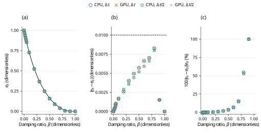

# Linear normal restitution across the complete Md=0 damping row

## Abstract

The complete sixteen-sphere Md=0 row from the PFC 7.0 public verification example is evaluated against its analytical restitution relation [1]. Four historical FunDEM runs cover CPU/GPU execution at $\Delta t=10^{-5}$ s and $\Delta t/2$, each to 1 s. All **64 historical absolute-error checks PASS** under the published coefficient-difference target of 0.01. Maximum absolute errors are 0.00826637 and 0.00799478 at the base and refined steps. This absolute criterion permits relative errors exceeding 50% at strong damping; individual errors are not uniformly reduced by refinement. PFC is commercial proprietary software and **was not executed locally**. The evidence from 28–29 October 2026 is an analytical-target comparison, not a new acceptance result for the current core.

## 1. Benchmark definition

The official example contains two rows of sixteen independent balls: Md=0 and Md=1 [1]. This case covers **only the complete Md=0 row**, including zero damping and the critical limit. The inactive lateral boundaries are replaced by a larger fixed native plane at $z=0$; the sixteen independent vertical paths remain inside the original floor footprint. No Md=1 no-tension clipping is claimed.

**Table 1. Published benchmark inputs and native realization.** Contact stiffness is prescribed directly; automatic damping follows from the exact restitution mapping.

| Quantity | Symbol | Value or realization |
| --- | --- | --- |
| Mobile bodies | $N_b$ | 16 independent spheres, original IDs 1–16 |
| Radius; density; mass | $R$; $\rho$; $m$ | 0.025 m; 2650 kg/m³; 0.173442094417 kg |
| Initial centers | $(x_i,y_i,z_i)$ | $x_i=0.05+0.1(i-1)$ m, $y_i=0.05$ m, $z_i=1$ m |
| Initial velocity and spin | $\mathbf{v}_i$; $\boldsymbol{\omega}_i$ | Zero; zero |
| Floor; gravity | $z_\mathrm{wall}$; $\mathbf{g}$ | Fixed at 0 m; (0, 0, −10) m/s² |
| Normal pair stiffness | $k_n$ | 50000 N/m |
| Damping ratios | $\beta_n$ | 0, 0.01, 0.02, 0.03, 0.04, 0.05, 0.1, 0.2, 0.3, 0.4, 0.5, 0.6, 0.7, 0.8, 0.9, 1 |
| Other channels | $k_t$, friction, rolling/twisting | Zero |
| Duration | $T$ | 1 s |
| Base step and count | $\Delta t$; $N$ | $10^{-5}$ s; 100000 |
| Refined step and count | $\Delta t/2$; $2N$ | $5\times10^{-6}$ s; 200000 |

With overlap $\delta=R-z$, upward signed normal force $F_n$ and positive gravity magnitude $g=10$ m/s², geometrical contact obeys

$$
F_n=k_n\delta-c_n v_z,\qquad m\ddot{\delta}+c_n\dot{\delta}+k_n\delta=mg,\qquad m=\frac{4\pi}{3}\rho R^3.\tag{1}
$$

No force acts outside geometrical contact. Signed unloading forces are retained; negative dashpot tails do not represent adhesion. For the fixed wall, effective contact mass equals the full sphere mass. The public unforced restitution relation, its critical limit and automatic damping are

$$
e_0=\exp\!\left(-\frac{\pi\beta_n}{\sqrt{1-\beta_n^2}}\right)\;(0\leq\beta_n<1),\qquad e_0(1)=0,\qquad c_n=2\beta_n\sqrt{mk_n}.\tag{2}
$$

The sphere and floor material restitutions combine harmonically. With floor value $e_w=1$, the exact inversion is

$$
e_0=\frac{2e_b e_w}{e_b+e_w}=\frac{2e_b}{1+e_b},\qquad e_b=\frac{e_0}{2-e_0}.\tag{3}
$$

This is an algebraic parameter translation, not fitted calibration. All 153 unordered native material pairs, including self-pairs, explicitly use the linear stiffness, zero stored manual dashpots and restitution-derived automatic damping. At $\beta_n=0$, $e_0=1$ and $c_n=0$; $\beta_n=1$ uses the implemented zero-restitution critical branch. The individual $\beta_n=0.2$ and 0.6 cases instead use identical sphere/floor material restitutions, whose harmonic value also equals the target contact coefficient.

**Table 2. Exact material-to-contact translation used in the historical sweep.** Displayed digits are retained from the detailed historical report; the native C++ program stores the corresponding full-precision constants.

| Source ball | $\beta_n$ (–) | Contact $e_0$ (–) | Sphere material $e_b$ (–) | Automatic $c_n$ (N·s/m) |
|---|---:|---:|---:|---:|
| 1 | 0 | 1 | 1 | 0 |
| 2 | 0.01 | 0.969070903976 | 0.939997627106 | 1.86248272162 |
| 3 | 0.02 | 0.939089562861 | 0.885173271925 | 3.72496544324 |
| 4 | 0.03 | 0.91001861853 | 0.834893727544 | 5.58744816486 |
| 5 | 0.04 | 0.88182261683 | 0.78862498035 | 7.44993088649 |
| 6 | 0.05 | 0.854467893007 | 0.745913525942 | 9.31241360811 |
| 7 | 0.1 | 0.729247614288 | 0.573870741843 | 18.6248272162 |
| 8 | 0.2 | 0.52662059933 | 0.35742362021 | 37.2496544324 |
| 9 | 0.3 | 0.372326104927 | 0.228747359071 | 55.8744816486 |
| 10 | 0.4 | 0.25382672198 | 0.145361703317 | 74.4993088649 |
| 11 | 0.5 | 0.163033534822 | 0.0887515030416 | 93.1241360811 |
| 12 | 0.6 | 0.0947802248422 | 0.0497476596023 | 111.748963297 |
| 13 | 0.7 | 0.0459879102603 | 0.0235351206381 | 130.373790514 |
| 14 | 0.8 | 0.0151646198645 | 0.00764024060449 | 148.99861773 |
| 15 | 0.9 | 0.00152375582052 | 0.000762458810785 | 167.623444946 |
| 16 | 1 | 0 | 0 | 186.248272162 |

## 2. Numerical method and verification procedure

CPU and CUDA GPU runs share all physical parameters and the same 1 s endpoint. The refined runs double the step count. The original velocity-Verlet audit accounts for the final velocity half kick; the force-assembly velocity is $v_{n,\mathrm{assembly}}=v_{z,\mathrm{saved}}-\Delta t(F_n/m-g)/2$. Force reconstruction uses Equation (1); division to infer $c_n$ excludes near-zero velocity denominators. Additional audits cover overlap, contact points/normals, effective mass/radius, pair mixing, spring energy, numerical drift/kick and gravity-plus-wall impulse.

The source first passes the first height minimum and then measures the first subsequent maximum. It evaluates

$$
e_h=\sqrt{\frac{\max(z_{\mathrm{apex}}-R,0)}{1-R}},\qquad E_{\mathrm{abs}}=|e_h-e_0|,\qquad \max_{i=1,\ldots,16} E_{\mathrm{abs},i}<0.01.\tag{4}
$$

The source FISH program computes an **absolute** coefficient difference and supplies no automated assertion. The published target is therefore not a relative 1% requirement. Diagnostic relative error is $100E_{\mathrm{abs}}/|e_0|$ when $e_0\ne0$; it is undefined at $e_0=0$. Gravity remains active during contact, whereas Equation (2) is unforced. A separate unfitted reference solves Equation (1) through contact and ballistic flight, including critical damping and permanent contact, without replacing the published target.

Quantitative measurements use every numerical step. Native binary frames at 1 ms are for retained visualization and do not define the sampled apex accuracy. For $\beta_n\geq0.6$, supplemental late-time checks over 0.8–1 s require height error $<10^{-9}$ m, relative force error $<10^{-6}$ and vertical speed $<10^{-8}$ m/s. Those are declared supplemental criteria, not official PFC thresholds.

## 3. Results and discussion

**Table 3. Historical restitution results for the sixteen damping ratios.** Values and digits are retained from the historical record. CPU values are displayed here; all 64 separate CPU/GPU records remain in the [checkpoint CSV](checkpoints/sixteen_beta_comparison.csv). At $\beta_n=0.9$, the first contact-height maximum remains below $R$, so the clamped height estimator yields $e_h=0$. At $\beta_n=1$, no apex is recorded, and the retained zero denotes the no-rebound convention. Neither zero represents an observed ballistic rebound or separation speed.

| $\beta_n$ (–) | $e_0$ (–) | $c_n$ (N·s/m) | CPU $e_h$, $\Delta t$ | CPU $e_h$, $\Delta t/2$ | $E_\mathrm{abs}$, $\Delta t$ | $E_\mathrm{abs}$, $\Delta t/2$ |
|---|---:|---:|---:|---:|---:|---:|
| 0 | 1.00000000 | 0 | 1.00000133 | 0.99999920 | 0.00000133 | 0.00000080 |
| 0.01 | 0.96907090 | 1.862483 | 0.96887616 | 0.96887555 | 0.00019475 | 0.00019536 |
| 0.02 | 0.93908956 | 3.724965 | 0.93872360 | 0.93872728 | 0.00036596 | 0.00036228 |
| 0.03 | 0.91001862 | 5.587448 | 0.90952129 | 0.90953161 | 0.00049733 | 0.00048701 |
| 0.04 | 0.88182262 | 7.449931 | 0.88086808 | 0.88107675 | 0.00095454 | 0.00074586 |
| 0.05 | 0.85446789 | 9.312414 | 0.85342489 | 0.85368077 | 0.00104301 | 0.00078712 |
| 0.1 | 0.72924761 | 18.62483 | 0.72754258 | 0.72763453 | 0.00170503 | 0.00161308 |
| 0.2 | 0.52662060 | 37.24965 | 0.52401744 | 0.52372422 | 0.00260316 | 0.00289638 |
| 0.3 | 0.37232610 | 55.87448 | 0.36830393 | 0.36873323 | 0.00402218 | 0.00359287 |
| 0.4 | 0.25382672 | 74.49931 | 0.24887051 | 0.24939242 | 0.00495621 | 0.00443430 |
| 0.5 | 0.16303353 | 93.12414 | 0.15730785 | 0.15782878 | 0.00572568 | 0.00520475 |
| 0.6 | 0.09478022 | 111.749 | 0.08815474 | 0.08886252 | 0.00662548 | 0.00591771 |
| 0.7 | 0.04598791 | 130.3738 | 0.03896948 | 0.03936429 | 0.00701843 | 0.00662362 |
| 0.8 | 0.01516462 | 148.9986 | 0.00689825 | 0.00716984 | 0.00826637 | 0.00799478 |
| 0.9 | 0.00152376 | 167.6234 | 0.00000000 | 0.00000000 | 0.00152376 | 0.00152376 |
| 1 | 0.00000000 | 186.2483 | 0.00000000 | 0.00000000 | 0.00000000 | 0.00000000 |



**Figure 1.** Historical first-rebound restitution for pfc-linear-restitution-md0-sweep. Panel (a) compares the retained first-apex height estimator $e_h=\sqrt{\max(z_{\mathrm{apex}}-R,0)/(z_{\mathrm{initial}}-R)}$ with the public PFC $M_d=0$ contact target $e_0=\exp[-\pi\beta/\sqrt{1-\beta^2}]$ for $0\leq\beta<1$, with $e_0=0$ at $\beta=1$ (black solid analytical curve or horizontal line). Panel (b) shows absolute coefficient errors and the strict published absolute-error limit 0.01 (black dashed line). Panel (c) shows relative discrepancy as a separate diagnostic, not the acceptance criterion. Blue open circles, orange crosses, green open squares and purple plus signs denote CPU at $\Delta t$, GPU at $\Delta t$, CPU at $\Delta t/2$ and GPU at $\Delta t/2$, respectively; all numerical observations are unconnected symbols, and coincident runs remain overlaid without averaging or jitter. $\Delta t=10^{-5}\,\mathrm{s}$; $\Delta t/2=5\times10^{-6}\,\mathrm{s}$. Sixteen independent damping ratios are retained per run. Relative discrepancy is undefined at $e_0=0$ ($\beta=1$) and that point is omitted only from (c); the largest plotted relative discrepancy is 100.000%. At $\beta=0.9$ and $\beta=1$, the retained $e_h=0$ denotes non-rebound. The recorded extremum at $\beta=0.9$ is below the nominal radius and is clamped to zero by the height estimator; $\beta=1$ has no recorded apex, so its retained zero is a non-rebound convention rather than an observed apex-height measurement. The black analytical curve is an evaluation of the stated closed-form equation, not interpolation of the numerical observations. All three ordinates are linear and exact zeros retain their true value. PFC was not executed locally: the reference is its published analytical relation, not a PFC numerical trajectory. The historical PASS records absolute-error acceptance only and does not imply small relative error at strong damping.

**Table 4. Historical maximum residuals and row-level absolute-error outcomes.** Force and impulse residuals are independent consistency diagnostics; the outcome column retains the published absolute-error comparison.

| Configuration | Maximum $E_\mathrm{abs}$ (–) | Maximum force residual (N) | Maximum impulse residual (kg·m/s) | Historical outcome |
| --- | ---: | ---: | ---: | --- |
| CPU, $\Delta t$ | 0.00826637 | $5.7\times10^{-14}$ | $1.1\times10^{-12}$ | PASS |
| GPU, $\Delta t$ | 0.00826637 | $1.1\times10^{-13}$ | $1.1\times10^{-12}$ | PASS |
| CPU, $\Delta t/2$ | 0.00799478 | $5.7\times10^{-14}$ | $4.3\times10^{-12}$ | PASS |
| GPU, $\Delta t/2$ | 0.00799478 | $1.1\times10^{-13}$ | $4.3\times10^{-12}$ | PASS |

The worst absolute error occurs at $\beta_n=0.8$. Despite satisfying the absolute target, relative errors against the unforced $e_0=0.01516462$ are **54.51% and 52.72%** at the base and refined steps. The continuous gravity-inclusive height coefficient is 0.00741005; it differs substantially from the unforced coefficient. At $\beta_n=0.9$ and 1, the spheres remain in contact and the reported $e_h=0$ is retained. An unobserved separation speed is not invented. At $\beta_n=0.9$, the nonzero unforced target and zero measured rebound imply a 100% relative discrepancy; at $\beta_n=1$, relative error is undefined because $e_0=0$. Only the undefined point is omitted from Figure 1(c), while its zero absolute error remains in Figure 1(b).

The row maximum error decreases with refinement, but individual errors do not do so uniformly. At $\beta_n=0.2$, absolute error increases from 0.00260316 to 0.00289638. Contact onset and the discrete first-apex estimator both depend on time step. No uniform monotonic convergence or convergence order is demonstrated by these two steps.

Maximum whole-history CPU/GPU differences are $1.18\times10^{-14}$ m in vertical position, $1.42\times10^{-12}$ m/s in vertical velocity and $2.05\times10^{-10}$ N in signed normal force. The impulse balance includes gravity and the external floor force; sphere momentum alone is not conserved. Damping intentionally dissipates energy, and an energy-conservation requirement is inappropriate for these impacts.

## 4. Conclusions and limitations

All 64 historical first-apex absolute-error checks satisfy the published target for the complete independent Md=0 row. The retained audit supports the exact material mixing, automatic damping, signed unloading and critical-limit realization. This result does **not** imply small relative restitution error at strong damping, uniform time-step convergence, or agreement with a locally run PFC solver.

The Md=1 row and the full 32-ball example remain outside scope. Active friction, disk inertia, rolling/torsional resistance and other PFC constitutive/loading operators are not tested; see the [coverage inventory](../../COVERAGE.md). Historical native-library execution and current dedicated C++ construction have distinct provenance, and the current case has no fresh automatic acceptance gate.

## References

1. Itasca Consulting Group. *Linear Contact Model: Calibrating the Normal Critical Damping Ratio*. PFC 7.0 documentation. [Official example and embedded FISH input](https://docs.itascacg.com/pfc700/pfc/docproject/source/manual/examples/verification/linear_contact_model/cmlinear_restitution.html). Accessed 31 October 2026. The original source-snapshot identity is retained in [PROVENANCE.md](PROVENANCE.md).

## Appendix A. Reproducibility and evidence

The [dedicated C++ program](pfc-linear-restitution-md0-sweep.cpp) constructs this case directly with the public native core. From the directory containing `FunDEMBeta/`, build and run the four configurations below. Use a CUDA-enabled build and an available CUDA device for the GPU commands; append `-DFUNDEM_ENABLE_CUDA=OFF` for a CPU-only build. Every output directory must be new.

```bash
cmake -S FunDEMBeta -B build -DFUNDEM_BUILD_VALIDATIONS=ON
cmake --build build --target pfc_pfc_linear_restitution_md0_sweep --parallel
build/validation/PFCComparison/pfc_pfc_linear_restitution_md0_sweep --mode cpu --output build/comparisons/pfc-linear-restitution-md0-sweep-cpu
build/validation/PFCComparison/pfc_pfc_linear_restitution_md0_sweep --mode gpu --output build/comparisons/pfc-linear-restitution-md0-sweep-gpu
build/validation/PFCComparison/pfc_pfc_linear_restitution_md0_sweep --mode cpu --half-step --output build/comparisons/pfc-linear-restitution-md0-sweep-cpu-half
build/validation/PFCComparison/pfc_pfc_linear_restitution_md0_sweep --mode gpu --half-step --output build/comparisons/pfc-linear-restitution-md0-sweep-gpu-half
```

The native program writes `trajectory.csv`, `contacts.csv`, `comparison.csv` and `summary.txt`. Its case definition has no fresh automatic acceptance gate: a completed run is **NOT EVALUATED**, and a capped `--steps N` run is **INCOMPLETE**. Evaluate new results independently using Equations (2)–(4); a historical PASS must not be copied into a new-run verdict. Multi-configuration generators require the configuration directory and the platform executable suffix; see the [family build instructions](../../README.md#build-and-run).

The numerical evidence consists of the [checkpoint table](checkpoints/sixteen_beta_comparison.csv), [historical numerical record](HISTORICAL-RESULTS.csv), its [field guide](HISTORICAL-RESULTS.md), [original detailed report](HISTORICAL-REPORT.md) and [source/archive provenance](PROVENANCE.md). The original campaign retained 4004 native frames, 600004 every-step wide trajectory rows representing 9600064 particle states, and 2080520 active-contact rows. Other transverse/spin/torque channels were checked inactive at every step. The original runs used SimulationSession linked to CPU/CUDA native libraries; identity with the installed GUI executable was not established. Full raw histories, native archives and execution logs remain retained separately and are not distributed here. Regenerating the figure from the checkpoint table does not execute PFC or rerun the physical benchmark.
